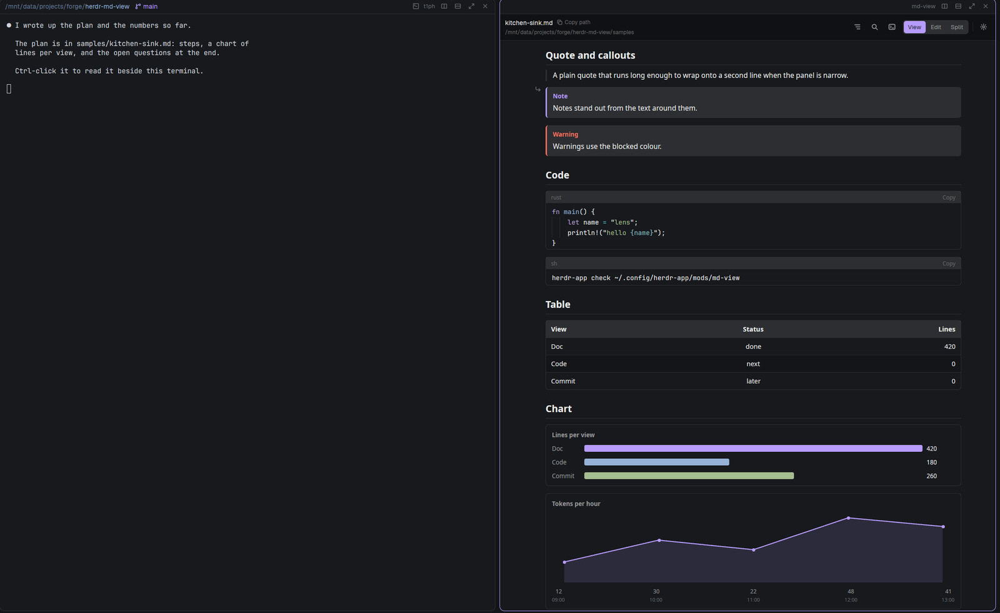

# md-view

A markdown panel for the [Herdr app](https://herdr.dev). Ctrl-click a `.md` path in any terminal (Cmd-click on macOS) and the file opens, rendered, in a panel beside that terminal. You can edit it there, and send any paragraph, list item or selection back to the terminal as a quote with its line numbers, which is handy for pointing a coding agent at part of a plan or a report.



## Install

You need the Herdr app 0.1.17 or later, which added link handlers for mods.

```sh
git clone https://github.com/temet-ai/herdr-md-view
cd herdr-md-view
./install.sh                 # the mod, plus the Mermaid and maths renderers
./install.sh --no-renderers  # the mod only
```

`install.sh` copies `mods/md-view` into `~/.config/herdr-app/mods/` (or `$HERDR_APP_HOME`), then runs `npm install` in `mods/md-view/tools`. The renderers need Node.js 18 or later; Mermaid also needs a Chromium-based browser (Chrome, Chromium, Edge or Brave), and the installer uses the one you have instead of downloading another. The renderer packages take about 500 MB. Without them, Mermaid and maths blocks show their source.

Herdr adds md-view to your layout's `link_handlers` the first time it sees the mod, on a layout of your own. The shipped `main` layout is read-only: clone it first and switch to the clone.

```sh
herdr-app do layout.clone '{"name":"main","as":"my-main"}'
```

To install by hand, copy `mods/md-view` into `~/.config/herdr-app/mods/` and run `herdr-app check ~/.config/herdr-app/mods/md-view`.

## Using it

- **Open:** Ctrl-click a path ending in `.md` or `.markdown`: `/abs/path.md`, `~/notes.md`, `./docs/plan.md`, `file:///…`, an OSC 8 link, or `path.md:42`. By default each tab has one panel beside the terminal, and a later click shows the new file in it; Settings can open files below, in a new tab or in a background tab instead.
- **View, Edit, Split:** the buttons in the panel header. Edit shows the source in Herdr's editor; Split shows the editor above the rendered page.
- **Save:** edits save on their own 800 ms after you stop typing. Ctrl+S (Cmd+S) saves at once. If another program changes the file while you edit, a banner asks whether to reload from disk or keep your version; nothing is overwritten without that answer.
- **Send to the terminal:** hover a block or list item and an arrow appears in the left margin. Click it to paste `path:12-14` and those lines, quoted with `>`, into the terminal you clicked from. In Edit and Split, **Send selection** sends the lines you selected. By default the text is pasted without Enter, so you can add your own words before sending it.
- **Links:** links to other markdown files open in the panel; web links and other files open with the system's handler.
- **Jump to a line:** `plan.md:42` opens at line 42 and flashes that block.
- **Outline:** the outline button (or `o`) lists the headings beside the page; click one to jump to it.
- **Find:** the search button, `/` or Ctrl+F. Matching blocks are highlighted; Enter and the arrows step through them.
- **What changed:** when another program (an agent, say) rewrites the open file, the changed blocks get an accent bar and the header shows "N changed"; click it, or press `c`, to step through them.
- **Back and forward:** after following links between files, the ‹ › arrows, Alt+Left and Alt+Right, or `[` and `]`.
- **Files the terminal mentioned:** the terminal button (or `f`) lists the markdown files named in the terminal's recent output, newest first. It finds bare names like `plan.md` too, which Herdr doesn't make clickable.

Keys while reading (click the page first): `j`/`k` or the arrows move a block, `g`/`G` go to the top or bottom, `o` outline, `/` find, `c` next change, `f` files from the terminal, `e` edit, Esc closes whatever is open.
- **Settings:** the Settings button in the panel header opens a settings page. Every change saves at once and applies to all open md-view panels.

To open a file without a click:

```sh
herdr-app do tab.new '{"mod":"md-view","props":{"file":"/path/to/notes.md"}}'
```

## What it renders

Headings, paragraphs with bold, italic, strikethrough, inline code and links; bullet, numbered and task lists with nesting; quotes; GitHub callouts (`> [!NOTE]`, `TIP`, `IMPORTANT`, `WARNING`, `CAUTION`); fenced code with syntax highlighting and a Copy button; tables with column alignment; images (local, relative to the file, or https); footnotes; front matter; horizontal rules.

Charts are fenced blocks marked `chart`:

````markdown
```chart
type: bar
title: Lines per view
Doc: 420
Code: 180
Commit: 260
```
````

`type` is `bar` (the default) or `line`. Every other line is `label: number`. Charts use your theme's colours.

Mermaid diagrams (```` ```mermaid ````) and maths (`$$ … $$` on their own lines, or ```` ```math ````) are rendered to images with the optional renderers and cached by their content, so a diagram renders again only when its text changes.

`samples/kitchen-sink.md` uses all of these.

## Settings

The Settings page in the panel covers everything below. It saves to `~/.config/herdr-app/md-view.json`, which you can also edit by hand ("Edit the settings file" on the page). The file lives outside the mod folder, so reinstalling keeps it.

| Key | Default | What it does |
|---|---|---|
| `placement` | `"right"` | Where a click opens the file: `"right"` or `"down"` of the terminal, `"tab"` (a new tab you are taken to) or `"background"` (a new tab that waits until you go to it). |
| `reuse_panel` | `true` | Beside or below: later clicks in the same tab show the new file in the open panel. `false` opens a panel per file. |
| `focus_panel` | `false` | Beside or below: move the keyboard to the panel. By default the terminal keeps it. |
| `mode` | `"view"` | The mode a new panel starts in: `"view"`, `"edit"` or `"split"`. |
| `file_types` | `["md", "markdown"]` | Extensions a Ctrl-click opens; the page offers `.md`, `.markdown`, `.mdx` and `.txt`. Changing it rewrites `mod.json`, which reloads md-view panels. |
| `font` | `"auto"` | `"auto"` picks an installed font with real bold and italic faces (Inter, Noto Sans and others on Linux, Helvetica Neue on macOS, Segoe UI on Windows). `"ui"` is Herdr's UI font, `"mono"` the terminal font; any other value is a font name. |
| `text_size` | `14` | Body text size in px; headings and code scale from it. |
| `max_width` | `860` | Widest the text column gets, in px. `0` fills the panel. |
| `remote_images` | `true` | Load images with http(s) addresses. |
| `allow_edit` | `true` | `false` makes md-view a read-only viewer: no Edit or Split. |
| `autosave` | `true` | Save while you edit. With `false`, a Save button appears and Ctrl+S saves. |
| `autosave_delay_ms` | `800` | How long after your last keystroke it saves. |
| `send.mode` | `"paste"` | `"paste"` types the text without Enter. `"submit"` sends it through herdr-core (`hc send`) and presses Enter. |
| `send.format` | `"quote"` | `"quote"`: the path and line range, then the lines as a `>` quote. `"plain"`: the lines only. |
| `send.keep_clipboard` | `true` | Paste mode goes through the clipboard; this puts back what was there afterwards. |
| `send.focus_terminal` | `true` | Submit mode: go to the terminal after sending. |
| `renderers.mermaid` | `true` | Render Mermaid blocks. |
| `renderers.math` | `true` | Render maths blocks. |
| `renderers.node` | `"node"` | The Node.js program that runs the renderers (file only). |
| `renderers.browser` | `"auto"` | The browser Mermaid uses; `"auto"` looks for an installed Chromium-based one (file only). |

## Limits

- Files larger than 1 MiB don't open (Herdr's file reading limit).
- Paths in terminals on other machines go to Herdr's normal opener.
- Inline maths (`$x^2$`) shows as code; only display maths renders.
- Herdr doesn't make bare names (`plan.md`) or `#L42` anchors clickable; use the terminal-files button for those.
- Paste mode briefly replaces the clipboard while it pastes.

## Building the parser

`mods/md-view/vendor/markdown.js` is markdown-it 15 with its footnote, GitHub alerts and front matter plugins, bundled into one file because mods can't install packages. To rebuild it:

```sh
cd build && npm install && npm run build
```

## Licence

MIT; see [LICENSE](LICENSE). The bundled parser's licences are in [THIRD-PARTY-NOTICES.md](THIRD-PARTY-NOTICES.md).
