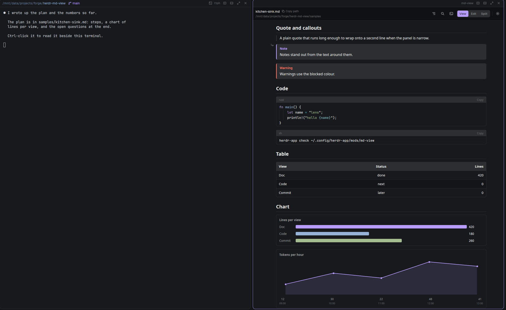

# md-view

A configurable markdown viewer and editor for Herdr. Ctrl-click a `.md` path in a terminal and it opens in a panel beside it, parsed with markdown-it and drawn with Herdr's own text and editor views.

## What you see

A pane split to the right of the clicked terminal (or below it, or in its own tab, by setting).

- **Header** (about 44 px, `chrome` background, 1 px `border` line below): the file name in 13 px semibold with ` ●` while there are unsaved edits, and the folder under it in 11 px `dim`. On the right: a View / Edit / Split switch (a `raised` pill; the active button filled with `accent`), Send selection (Edit and Split only), the save state in 11 px `dim` (Unsaved, Saving…, Saved, or Not saved in `blocked`), Copy path, a copy button for the whole file's markdown, Settings and ✕.
- **Banners** under the header, `raised` with a `blocked` line: the settings file failed to parse; the file changed on disk while you were editing (Reload from disk, Keep mine and save); or another file was clicked while edits were unsaved (Save now, Discard).
- **The page**: a scrolling column centred in the panel, at most 860 px wide, text 14 px in a font with real bold and italic faces. Headings are 24, 19, 16 and 15 px semibold; h1 and h2 have a 1 px `border` rule under them. Lists show `•` or `1.` markers in `dim`, nested 18 px per level; task items show a 12 px box, filled with `accent` and a ✓ when done, and done items in `muted`. Quotes have a 3 px `border` bar on the left. Callouts are `raised` cards with a 3 px left bar and a 12 px semibold title in the callout's colour (note `accent`, tip `ansi2`, important `ansi5`, warning `blocked`, caution `ansi1`). Code blocks are `background` cards with a `raised` strip holding the language and Copy, then Herdr's read-only editor with syntax colours. Tables are bordered with a `raised` header row and every other row in `canvas`. Bar charts are one row per value (label, a 14 px bar in the theme palette, the number); line charts are a 140 px plot with an `accent` line, a faint filled area and 6 px dots, labels under it. Images, Mermaid diagrams and maths are shown at their own size, never wider than the column.
- **Gutter**: a 22 px column left of every block and list item. Hovering the row shows a 14 px send arrow there (`dim`, `accent` on hover). A 22 px column on the right shows a 13 px copy icon on hover, which copies the block's markdown. A Ctrl+C on the rendered page is followed by a swap: md-view reads the plain text the view copied, finds it in the file (`copy.js` `markdownFor`) and puts the markdown it came from on the clipboard, whole lines with their list or heading markers, part of a line with its emphasis, code ticks and link closed.
- **Edit mode** replaces the page with Herdr's editor (markdown highlighting, line numbers, soft wrap). **Split** shows the editor above the page.

## How it behaves

- A Ctrl-click (Cmd-click on macOS) on a local markdown path in a terminal opens the panel, or shows the file in the tab's existing panel without taking the keyboard from the terminal.
- The page reloads when the file changes on disk. While editing, a change on disk raises the conflict banner instead.
- Edits save 800 ms after the last keystroke, through a write that fails if the file changed since it was read. Ctrl+S saves at once. With auto-save off there is a Save button.
- The send arrow, or Send selection, puts `path:start-end` and the lines as a `>` quote into the source terminal. Paste mode copies it to the clipboard, focuses the terminal, pastes without Enter, and puts the old clipboard back 600 ms later. Submit mode uses `hc send`, which presses Enter. If the source terminal is gone, the first terminal in the tab is used.
- Links to markdown files open in the panel; other links go to the system handler.
- Settings (header button) swaps the page for a settings page: sections Opening (Beside, Below, New tab, Background tab; reuse panel; move the keyboard; start mode; file types), Reading (font, text size, width, web images), Editing (auto-save, delay), Sending (paste or submit, quote or plain, restore clipboard, focus after submit) and Diagrams (Mermaid, maths), as segmented pills, 34×20 px toggles, a − / + stepper and chips. Each change writes `~/.config/herdr-app/md-view.json`, sets shared `md-view.config-rev` so every copy reloads it, and rewrites `mod.json` when the file types change.
- Mermaid and maths show "rendering…" with their source until the image is ready, and the error and source if rendering fails.

## Built from

- `mods/md-view/mod.json`: `{"place": "none", "link_handlers": [{"kind": "file", "pattern": "(?i)\\.(md|markdown)$"}]}`. Herdr adds the mod to a personal layout's root `link_handlers`.
- `link.js`: `handleLink(click)` returns `"pass"` without a local path or tab. Otherwise it reads the settings. New tab and Background tab run `tab.new {mod: "md-view", props: {file, source}, focus}`. Beside and Below set shared `md-view.file.<tab>` to `{path, pane, terminal, machine, at}` and run `pane.split {direction, pane, mod: "md-view", props: {tab}}` when the tab has no md-view pane (or always, with `props: {file, source}`, when reuse is off), then `pane.focus` back to the terminal unless the panel should take the keyboard.
- `settings.js`: the settings page; `config.js` `saveConfig` writes the file and `mod.json`.
- `main.js`: the view. It reads `shared("md-view.file.<tab>")` (or `props().file`), loads with `readTextFile`, loops on `watchFolder` of the file's folder, saves with `writeTextFile(path, text, expected)`, and auto-saves with `cx.timer.after`. Code-block and main editors are `EditorState.new`, created in tasks and handlers only (never in `render`). Text inside paragraphs, list items and table cells is `TextView.markdown`; everything else is laid out with `div`, `h_flex` and `v_flex`. Line charts use `window.paint_path` with pixel coordinates from the plot's `on_size_change`. Sending uses `cx.write_to_clipboard`, `pane.focus` and `terminal.paste`, or `hc(["send", …])`.
- `blocks.js`: markdown-it tokens to blocks, each with its 0-based source line range, which is what the send button quotes.
- `config.js`: the defaults, merged with `md-view.json`; picks the font with `fc-list` on Linux.
- `media.js`: copies or downloads images into `~/.config/herdr-app/.cache/md-view` (with `fs`, `fetch`, or `cp` outside the home folder) and reads their size from the file header; runs `tools/render.mjs` for diagrams.
- `vendor/markdown.js`: markdown-it 15 with footnote, GitHub alerts and front matter, bundled by `build/` with esbuild.
- `tools/render.mjs` with npm packages `@mermaid-js/mermaid-cli` (PNG at 2×, transparent, dark or default theme, run in an installed Chromium-based browser) and `mathjax-full` (SVG, ex units converted to px, `currentColor` set to the theme's `foreground`). Output names are a hash of kind, colour and text.
- `features.js`: jump to a line or block (a `ScrollHandle` on the page, scrolled to the end and then back so the target lands at the top), outline, find (`InputState` + `Input`), back and forward, changed-section marks (blocks whose source is new after a disk change), the terminal-files picker (`hc read`, a markdown-name pattern, `test -f`, `find` for bare names) and the keys.
- Icons, all 16 px drawn with `currentColor`: `send.svg`, `copy.svg`, `gear.svg`, `outline.svg`, `search.svg`, `terminal-files.svg`, `file.svg`, `sparkle.svg` (the settings footer, turning with `.spin`).

## Watch out

- `EditorState.new` throws if called during `render`.
- `image()` loads only from the Herdr home folder, so every image must be copied into it first.
- Herdr's bundled UI font draws no bold or italic inside `TextView.markdown`; set `font_family` on the page to a font that has those faces.
- Unicode symbols such as `↪` draw as colour emoji and ignore `text_color`; use an SVG icon.
- `paint_path` ignores percentage coordinates for paths here; measure the element and pass pixels, unscaled by zoom.
- A link handler's `pane.focus` would take the keyboard from the terminal the person is typing in; don't focus the panel on a click.
- `fs` reads only inside the home folder; files elsewhere need `exec("cp")`.
- `readTextFile` returns null for files over 1 MiB.
- Clicks in shipped layouts reach the mod only after the person clones the layout.

## Done when

- `herdr-app check mods/md-view` passes.
- Ctrl-clicking `/abs/path/samples/kitchen-sink.md` in a terminal opens a pane to its right with every section rendered, including both charts, the image, the Mermaid diagram and the formula.
- Ctrl-clicking another `.md` in the same tab shows it in the same pane, and the terminal keeps the keyboard.
- Edit, type, wait one second: the file on disk has the change and the header says Saved.
- Change the file from the terminal while editing: the conflict banner appears and nothing is overwritten.
- Hover a list item, click the arrow: the terminal's prompt holds `path:N` and the quoted line, without Enter, and the clipboard holds what it held before.
- Set `"placement": "tab"` in Settings and Ctrl-click: the file opens in a new tab.
