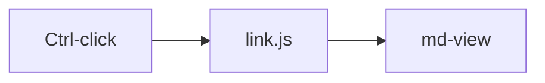

# md-view kitchen sink

A paragraph with **bold**, *italic*, ~~struck~~, `inline code`, a [link](https://herdr.dev) and a bare URL https://github.com/herdrdev/herdr-app.

## Lists

- First item
- Second item with `code`
  - Nested item
- [x] Done task
- [ ] Open task

1. One
2. Two
3. Three

## Quote and callouts

> A plain quote that runs long enough to wrap onto a second line when the panel is narrow.

> [!NOTE]
> Notes stand out from the text around them.

> [!WARNING]
> Warnings use the blocked colour.

## Code

```rust
fn main() {
    let name = "lens";
    println!("hello {name}");
}
```

```sh
herdr-app check ~/.config/herdr-app/mods/md-view
```

## Table

| View | Status | Lines |
|:-----|:------:|------:|
| Doc  | done   | 420   |
| Code | next   | 0     |
| Commit | later | 0    |

## Chart

```chart
type: bar
title: Lines per view
Doc: 420
Code: 180
Commit: 260
```

```chart
type: line
title: Tokens per hour
09:00: 12
10:00: 30
11:00: 22
12:00: 48
13:00: 41
```

## Image


## Mermaid



## Maths

Inline $E = mc^2$ and a block:

$$
\sum_{i=1}^{n} i = \frac{n(n+1)}{2}
$$

## Footnote and rule

A claim that needs a source.[^1]

---

[^1]: The footnote text.
